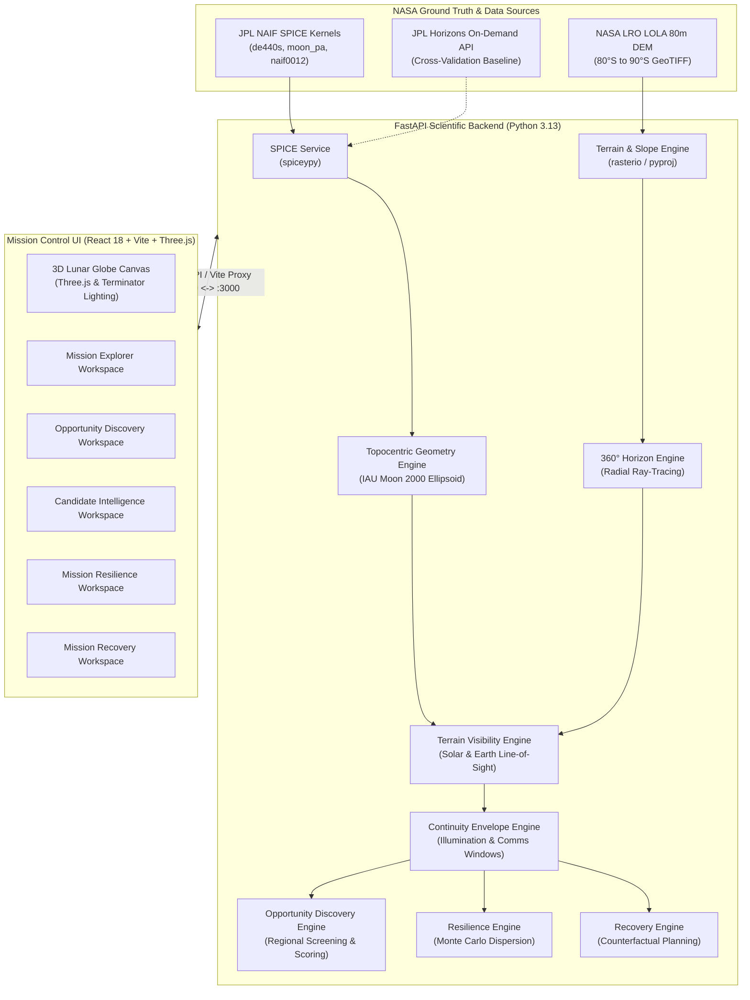

# LUNAR EDGE | Mission Opportunity & Constraint Analysis System

<div align="center">
**[](https://lunar-edge-seven.vercel.app/)**\
**🌐 Live Website:** [](https://lunar-edge-seven.vercel.app/)**
</div>


**An aerospace-grade mission planning, autonomous landing opportunity discovery, and constraint verification platform for the lunar south pole.**

[Overview](#-overview) • [Key Features](#-key-features) • [System Architecture](#-system-architecture) • [Science & Engineering Engines](#-science--engineering-engines) • [Workspaces](#-interactive-mission-control-workspaces) • [Installation & Setup](#-installation--setup) • [Validation & Tests](#-verification--testing)

</div>

---

## 🛰️ Overview

Landing at the lunar south pole (e.g., NASA Artemis III, VIPER, and commercial CLPS landers) is governed by severe celestial and topographical conditions:

1. **Extreme Low-Angle Solar Grazing**: The Moon's obliquity is only ~1.54°, causing the Sun to circle along the local horizon at polar latitudes. Small topographical features cast shadows that stretch across tens of kilometers.
2. **Lunar Libration & Direct-to-Earth (DTE) Comms**: The Moon's orbital eccentricity and axial inclination cause libration (~7° in latitude, ~8° in longitude). At polar regions, Earth oscillates across the local horizon in a ~27.3-day cycle, frequently severing direct line-of-sight communications.
3. **Rough Cryogenic Relief**: Permanently Shadowed Regions (PSRs) coexist with high-elevation massifs (e.g., Malapert Mountain, Shackleton Connecting Ridge, Nobile Rim), with steep boulder-strewn slopes exceeding lander tip-over thresholds (>15°).

**LUNAR EDGE** solves these challenges by fusing **NASA/JPL SPICE ephemerides**, authentic **NASA LOLA 80m/pixel Digital Elevation Models (DEM)**, real-time 360° horizon ray-tracing, Monte Carlo landing dispersion modeling, and automated counterfactual recovery intelligence into a flight-dynamics-grade mission planning platform.

---

## 🚀 Key Features

* **Authentic NASA/JPL SPICE Ephemeris Toolkit**: High-precision planetary ephemerides (`de440s.bsp`), high-accuracy binary lunar orientation (`moon_pa_de440_200625.bpc`), leap seconds (`naif0012.tls`), and planetary constants (`pck00011.tpc`).
* **LOLA 80m Digital Elevation Model**: Direct integration with NASA Lunar Reconnaissance Orbiter (LRO) LOLA topography (`LDEM_80S_80MPP_ADJ.TIF`) for sub-pixel elevation, slope, and aspect calculations.
* **360° Ray-Traced Horizon Obstruction**: High-fidelity line-of-sight horizon profiling accounting for lunar surface curvature and local terrain elevation angles.
* **Continuous Operations Envelope**: Quantitative evaluation of uninterrupted solar power, maximum tolerable darkness (battery discharge limits), continuous Direct-to-Earth (DTE) communications, and simultaneous operational windows.
* **Autonomous Opportunity Discovery**: Region-wide screening across NASA candidate landing zones (Shackleton Ridge, Nobile 1 & 2, Haworth Rim, de Gerlache Rim, Malapert Mountain) with multi-attribute scoring and automated natural-language explainability.
* **Probabilistic Resilience & Monte Carlo Dispersion**: Simulates 1σ to 3σ spatial landing dispersion ellipses, clock jitter, and horizon elevation uncertainty to predict mission survival probability.
* **Counterfactual Mission Recovery**: Automated diagnostic engine that identifies binding failure constraints and synthesizes concrete interventions: temporal launch window shifts, spatial terrace relocations, and operational duty-cycle adaptations.
* **Interactive 3D Mission Control UI**: Three.js WebGL lunar globe with accurate sub-solar terminator shading, day/night division, site telemetry markers, and responsive multi-workspace analytics.

---

## 🏛️ System Architecture



---

## 🔬 Science & Engineering Engines

### 1. Module A: Authentic SPICE Ephemeris Engine (`spice_service.py`)
Computes barycentric and selenocentric positions and velocities for Sun and Earth in the high-precision lunar body-fixed frame (`MOON_PA_DE440`):
* Converts UTC strings to Ephemeris Time (ET/TDB) using leap-second kernels.
* Computes planetary radii, instantaneous distances, and apparent topocentric angular diameters for both Sun and Earth.
* Independently cross-validated against live JPL Horizons API ephemeris queries.

### 2. Module B: Topocentric Celestial Geometry Engine (`geometry_engine.py`)
Translates selenographic coordinates (latitude, longitude, elevation) into local topocentric **Up-North-East (UNE)** reference frames:
* Robust orthonormal basis formulation with polar singularity compensation at $\pm 90^\circ$ latitude.
* Sub-solar and sub-Earth ground track calculations, solar incidence, azimuth ($0^\circ - 360^\circ$ clockwise from North), and elevation relative to the local horizontal plane.

### 3. Module C: LOLA High-Resolution Terrain Engine (`terrain_engine.py` & `horizon_engine.py`)
Directly samples the NASA LOLA South Pole stereographic Digital Elevation Model (`LDEM_80S_80MPP_ADJ.TIF`):
* Computes surface elevation, finite-difference gradient slopes, and topographic aspect.
* **360° Radial Ray-Tracing**: Sweeps 360 azimuth bins out to maximum horizons, factoring in lunar spherical curvature:
  $$\Delta z(r) = z(r) - \left(z_0 - \frac{r^2}{2 R_{\text{moon}}}\right)$$
* Generates continuous horizon obstruction profiles determining true line-of-sight elevation cutoffs.

### 4. Module D: Continuity Envelope & Visibility Engine (`visibility_engine.py` & `continuity_engine.py`)
Evaluates true line-of-sight occlusion by comparing apparent celestial body elevation against the local 360° horizon profile:
* **Solar Illumination**: Models solar disc center and upper-limb grazing conditions.
* **Earth Direct-to-Earth (DTE)**: Evaluates RF link visibility accounting for lunar libration cycles.
* **Mission Metrics**: Computes longest continuous sunlit window, longest dark duration, longest comms window, and simultaneous operational envelopes.

### 5. Module E: Autonomous Opportunity Discovery Engine (`discovery_engine.py`)
Performs automatic multi-criteria evaluation of landing sites across the lunar south pole:
* Evaluates terrain safety ($\text{slope} \le \text{threshold}$), illumination reliability, and comms availability.
* Computes a normalized composite mission score:
  $$\text{Score} = w_{\text{sun}} \cdot S_{\text{sun}} + w_{\text{comms}} \cdot S_{\text{comms}} + w_{\text{sim}} \cdot S_{\text{sim}} - w_{\text{slope}} \cdot S_{\text{slope}}$$
* Generates structured natural language explainability diagnosing binding constraints.

### 6. Module F: Probabilistic Resilience Engine (`resilience_engine.py`)
Evaluates operational risk under real-world navigation uncertainty:
* Generates 2D Gaussian landing dispersion ellipses ($1\sigma, 2\sigma, 3\sigma$).
* Propagates terrain slope variations, clock jitter, and horizon elevation noise.
* Computes empirical Cumulative Distribution Functions (CDF) for mission survivability.

### 7. Module G: Counterfactual Recovery Engine (`recovery_engine.py`)
Synthesizes verified recovery actions when a site fails mission requirements:
* **Temporal Shifting**: Identifies optimal launch window offsets ($\Delta t$) that align with peak solar illumination.
* **Spatial Terrace Relocation**: Identifies adjacent low-slope ridges or elevated terraces that restore line-of-sight.
* **Operational Adaptation**: Recommends relaxed duty-cycles, reduced power thresholds, or phased battery storage modes.

---

## 🖥️ Interactive Mission Control Workspaces

The frontend provides five specialized operational workspaces accessible via the top navigation stepper:

| Workspace | Description | Key Capabilities |
| :--- | :--- | :--- |
| **1. Mission Explorer** | Interactive 3D Lunar Environment | Three.js WebGL globe, real-time sub-solar terminator, site selection, elevation/slope telemetry, 360° horizon charts, timeline scrubber. |
| **2. Opportunity Discovery** | Autonomous Site Screening | South polar candidate ranking (Viable, Conditional, Infeasible), composite scoring, constraint satisfaction matrix, explainability cards. |
| **3. Candidate Intelligence** | Comparative Multi-Site Analysis | Cross-site comparison matrix, radar trade-off diagrams, multi-parameter correlation, terrain hazard profiles. |
| **4. Mission Resilience** | Probabilistic Monte Carlo Modeling | Landing dispersion ellipses, cumulative survival probability curves (CDF), sensitivity analysis against landing error and clock drift. |
| **5. Mission Recovery** | Counterfactual Planning Engine | Automated root-cause bottleneck isolation, actionable spatial/temporal recovery plans, delta-gain calculations. |

---

## 📁 Repository Structure

```text
nasa/
├── backend/
│   ├── app/
│   │   ├── api/                  # FastAPI router endpoints
│   │   ├── engines/              # Scientific engines
│   │   │   ├── continuity_engine.py
│   │   │   ├── discovery_engine.py
│   │   │   ├── geometry_engine.py
│   │   │   ├── horizon_engine.py
│   │   │   ├── mission_engine.py
│   │   │   ├── recovery_engine.py
│   │   │   ├── resilience_engine.py
│   │   │   ├── terrain_engine.py
│   │   │   └── visibility_engine.py
│   │   ├── models/               # Pydantic schemas and data contracts
│   │   ├── services/             # SPICE and JPL Horizons connectors
│   │   │   ├── horizons_service.py
│   │   │   └── spice_service.py
│   │   ├── utils/                # Coordinate transforms and date parsing
│   │   └── main.py               # Application entry point & CORS configuration
│   ├── data/
│   │   ├── kernels/              # NAIF SPICE ephemeris kernels
│   │   ├── raw/lola/             # NASA LOLA 80m South Pole GeoTIFF DEM
│   │   └── manifest.json         # Data provenance and checksum registry
│   ├── tests/                    # 114 unit, integration, and physics tests
│   ├── download_kernels.py       # Automated kernel fetching tool
│   ├── requirements.txt          # Python dependencies
│   └── run_all_validation.py     # Independent aerospace validation script
├── frontend/
│   ├── public/                   # Lunar textures and assets
│   ├── src/
│   │   ├── components/
│   │   │   ├── 3d/               # Three.js Lunar Globe Canvas
│   │   │   ├── charts/           # Plotly horizon and timeline visualizations
│   │   │   ├── layout/           # TopBar, Sidebar, TimelineDock, Inspector
│   │   │   ├── panels/           # Mission config modal and site comparison
│   │   │   └── workspaces/       # 5 Core Mission Control Workspaces
│   │   ├── services/             # API client services
│   │   ├── types/                # TypeScript type definitions
│   │   ├── App.tsx               # Root component & state orchestration
│   │   └── main.tsx              # React DOM entry point
│   ├── package.json
│   ├── tailwind.config.js
│   └── vite.config.ts
├── demo_video/                   # Full-resolution walkthrough demonstration
│   └── lunar_edge_mission_control_demo.mp4
└── README.md
```

---

## 🛠️ Installation & Setup

### Prerequisites
* **Python**: 3.10+ (tested on Python 3.13)
* **Node.js**: 18+ and npm
* **C++ Build Tools / CSPICE**: Pre-compiled binary wheels available for `spiceypy`

---

### Step 1: Clone the Repository
```bash
git clone https://github.com/your-org/lunar-edge.git
cd lunar-edge
```

---

### Step 2: Backend Setup

1. **Create and activate a virtual environment**:
   ```bash
   cd backend
   python -m venv .venv

   # Windows (PowerShell)
   .\.venv\Scripts\Activate.ps1

   # Linux / macOS
   source .venv/bin/activate
   ```

2. **Install dependencies**:
   ```bash
   pip install -r requirements.txt
   ```

3. **Verify/Download SPICE Kernels and LOLA DEM**:
   ```bash
   python download_kernels.py
   ```
   *Kernels will be fetched directly from NASA NAIF and verified against SHA-256 hashes registered in `manifest.json`.*

4. **Start the FastAPI backend server**:
   ```bash
   uvicorn app.main:app --host 127.0.0.1 --port 8000 --reload
   ```
   *The backend will be available at [http://localhost:8000](http://localhost:8000) with interactive Swagger documentation at [http://localhost:8000/docs](http://localhost:8000/docs).*

---

### Step 3: Frontend Setup

1. **Install frontend dependencies**:
   ```bash
   cd ../frontend
   npm install
   ```

2. **Start the Vite development server**:
   ```bash
   npm run dev
   ```
   *The Mission Control UI will open at [http://localhost:3000](http://localhost:3000).*

---

## 🧪 Verification & Testing

LUNAR EDGE includes a comprehensive suite of **114 automated tests** covering ephemeris conversions, coordinate transformations, horizon ray-casting, continuity envelopes, Monte Carlo resilience, and counterfactual recovery.

### Running Pytest
```bash
cd backend
python -m pytest tests -v
```

Expected result:
```text
======================= 114 passed in 22.15s =======================
```

### Running Aerospace Ephemeris & Horizons Validation
To run direct cross-validation between local SPICE calculations and the JPL Horizons online system:
```bash
cd backend
python run_all_validation.py
```

This verifies:
* Orthonormal Up-North-East basis consistency across polar coordinates.
* Bidirectional UTC $\leftrightarrow$ ET epoch precision.
* Sub-arcsecond alignment between SPICE topocentric coordinates and JPL Horizons ephemerides.
* 7-day multi-epoch continuous time-series without discontinuities or numerical singularities.

---

## 📹 Demonstration Video

A 1080p full-length demonstration showcasing all 5 operational workspaces, real-time 3D Moon rotation, autonomous discovery filtering, Monte Carlo dispersion, and counterfactual recovery is available at:
`demo_video/lunar_edge_mission_control_demo.mp4`

---

## 📚 Data Sources & Acknowledgments

* **NASA Planetary Data System (PDS) Geosciences Node**: LOLA Gridded Data Records (GDR) and South Pole DEMs.
* **NASA Navigation and Ancillary Information Facility (NAIF)**: SPICE ephemeris system, DE440 planetary ephemeris, and lunar orientation binary kernels.
* **NASA Jet Propulsion Laboratory (JPL)**: Horizons On-Demand Ephemeris API.
* **NASA Artemis Program**: Candidate landing region designations and mission operational constraints.

---

<div align="center">
Developed for the NASA Space Apps Challenge 2026.
</div>
